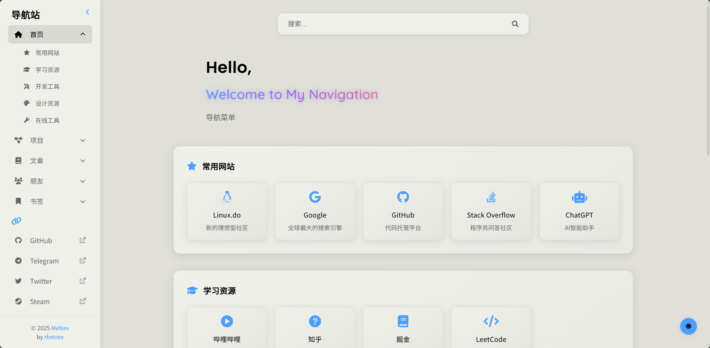
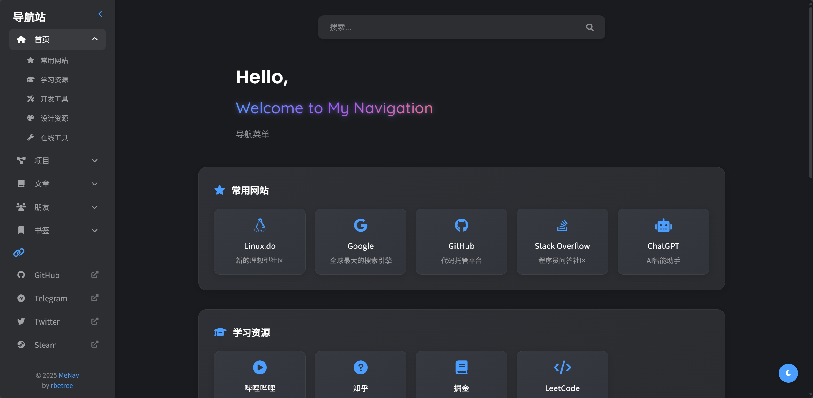

<div align="center">
  
  <h1>MeNav</h1>
  <p>轻量的个人导航网站生成器 · 纯静态默认部署 · 可选 Cloudflare 在线后台</p>
  <p>
    <a href="https://rbetree.github.io/menav/">在线预览</a> ·
    <a href="docs/install.md">安装与部署</a> ·
    <a href="docs/configuration.md">配置指南</a>
  </p>
</div>

[](LICENSE)
[](https://github.com/rbetree/menav/stargazers)
[](https://github.com/rbetree/menav/network/members)

MeNav 基于 Astro、原生 JavaScript 与 YAML 构建，默认生成单页静态导航站，支持从浏览器书签 HTML 批量导入网站链接（可配合 [MarksVault](https://github.com/rbetree/MarksVault) 自动推送），也支持开启基于 Cloudflare 的在线管理后台。

如果觉得项目有用，欢迎 Star/Fork 支持，谢谢！

> 本仓库同时作为**模板与示例站**（示例内容位于 `config/_default/`）。个人使用请 Fork 或新建独立仓库，配置放在 `config/user/`。

<p align="center">
  
  
</p>

## 核心特性

- **两种运行形态**：默认纯静态（YAML 驱动、零后端）；可选 Cloudflare 动态后台（在线编辑、静态快照发布）。
- **模块化配置与多层级分类**：支持 2~4 层嵌套分类、Markdown 内容页、明暗主题、拼音/首字母本地搜索与外部搜索引擎切换。
- **书签批量导入**：支持导入 Chrome/Firefox/Edge/Safari 导出的 HTML 书签，配合 MarksVault 与 GitHub Actions 自动转换并发布。
- **时效性数据聚合**：支持定时同步 GitHub 仓库统计、贡献热力图与 RSS 文章列表。

## 选择适合你的形态

| 维度         | 形态一：纯静态站点（默认推荐）                             | 形态二：Cloudflare 动态后端（可选）                                                |
| ------------ | ---------------------------------------------------------- | ---------------------------------------------------------------------------------- |
| **适合人群** | 不想维护后端、习惯用 Git / YAML 或书签导入的个人用户       | 需要网页管理台在线增删改查、接受 Cloudflare 运维成本的用户                         |
| **数据来源** | 仓库内 `config/user/` YAML 与 `content/` Markdown          | Cloudflare D1 数据库（运行时公开站仍为静态快照，不回写仓库）                       |
| **部署方式** | GitHub Pages、Vercel、Netlify、Cloudflare Pages、Docker、自有服务器 | Cloudflare Worker（API + 管理台）+ D1 + Access + Pages Git 项目                    |
| **维护成本** | 极低，Fork 后即可自动构建                                  | 需配置并维护 4 类 Cloudflare 资源与凭证轮换                                        |

> 动态后端需要 Cloudflare 账号。

## 技术栈

- Astro（静态页面构建）
- HTML5 + CSS3
- JavaScript（原生）
- YAML 模块化配置
- Google Favicon API + Font Awesome 图标

运行环境要求：Node.js `22.23.4+`，包管理器使用 npm。

## 项目结构

```text
menav/
├── src/          # Astro 页面/组件、数据准备、书签处理、前端脚本
├── scripts/      # 构建、开发、同步、检查与后端工具脚本
├── config/       # 模块化配置
├── content/      # Markdown 内容页
├── assets/       # 静态资源
├── bookmarks/    # 书签导入入口
├── workers/      # Cloudflare 动态后端（可选）
├── admin/        # 动态后端管理台静态资源
├── docs/         # 文档中心
└── dist/         # 构建产物
```

## 快速开始

### 方式 A：GitHub Pages 一键部署（形态一，推荐）

1. **Fork 本仓库**到你的 GitHub 账号。
2. 进入仓库 **Actions** 页面，点击启用 Workflows。
3. 进入 **Settings → Pages**，将 Build and deployment 的 Source 设为 **GitHub Actions**。
4. 在本地克隆仓库，先运行 `npm install`，再运行 `npm run init-config` 初始化 `config/user/`；修改后将 `config/user/` 提交并推送到 `main` 分支，等待自动部署。

> GitHub Pages 需要公开仓库。私有仓库请改用 Cloudflare Pages、Vercel 等第三方托管，并设置 `ENABLE_GITHUB_PAGES=false`。

### 方式 B：本地开发与预览

运行环境要求：**Node.js >= 22.23.4**（可使用 `nvm use` 切换）。

```bash
git clone https://github.com/rbetree/menav.git
cd menav
npm install
npm run init-config      # 从 config/_default/ 初始化 config/user/
npm run dev              # 同步缓存、构建并启动本地预览（默认 http://localhost:5173）
```

常用命令：

```bash
npm run dev:offline      # 离线启动本地预览（不刷新 RSS / GitHub 缓存）
npm run dev:astro        # Astro 开发模式（组件热更新）
npm run import-bookmarks # 将 bookmarks/*.html 转换为 config/user/pages/bookmarks.yml
npm run build            # 离线构建静态产物到 dist/
npm run sync             # 刷新 RSS、projects 仓库统计与贡献热力图缓存
npm run check            # 提交前快速检查（等同于 check:fast）
npm run check:fast       # lint + 单元测试 + 构建 + 审计 + 类型检查
npm run check:browser    # 真实浏览器契约测试（需先安装 Playwright Chromium）
```

### 方式 C：让 AI 帮你安装

把下面这句话发给 Claude Code、Cursor、Gemini CLI 等支持读写文件和终端的 AI；它会先阅读安装指南，再按你的选择协助你安装。

> 请先阅读仓库 https://github.com/rbetree/menav 里的 `docs/ai-install.md` 协助我安装 MeNav

## 文档导航

- **[安装与部署指南](docs/install.md)**：GitHub Pages、Docker、自有服务器、第三方 CI/CD 与 Cloudflare 动态后端完整安装步骤
- **[AI 安装指南](docs/ai-install.md)**：给 Claude Code / Cursor / Gemini CLI 的安装规范、工具准备与安全边界
- **[配置指南](docs/configuration.md)**：`site.yml`、`pages/*.yml`、完全替换策略、多层级分类与 Markdown 内容页
- **[书签导入指南](docs/bookmarks.md)**：浏览器书签 HTML 导出、导入命令、确定性输出与 MarksVault 扩展集成
- **[动态后端运维手册](docs/backend.md)**：Worker + D1 + Access + Pages 的数据契约、版本发布、回滚与故障排查
- **[开发与架构说明](docs/development.md)**：Astro 单页架构、构建流程、运行时契约、CSS 模块化与测试命令
- **[路线图](docs/roadmap.md)** 与 **[更新记录](CHANGELOG.md)**
- **[历史迁移说明](docs/migrations/2025-12-27.md)**：破坏性变更与配置迁移要点

## Star History

[](https://www.star-history.com/#rbetree/menav&Date)
